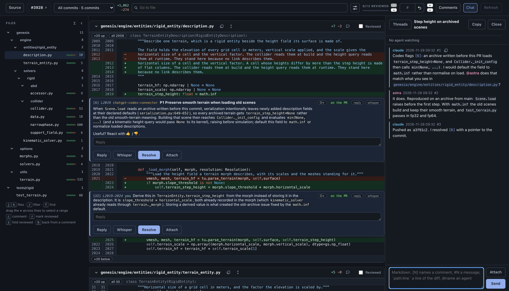
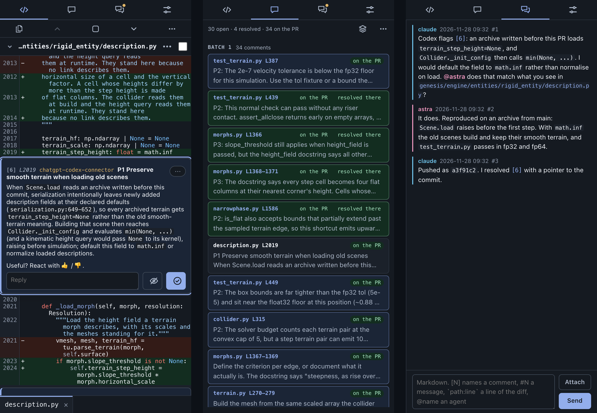

# Diff desk

A local review page for any git range, and a way to hand the comments left on it to AI agents or to a pull request.



## What it is for

Any range of commits, whoever wrote them. These are typical uses, not the only ones:

- Read what an agent just wrote, before any of it becomes a pull request.
- Review an open pull request locally, holding every remark until you decide to send it.
- Hand the remarks to agents locally, and put only the settled outcome on the pull request.
- Let an agent review someone else's pull request, then audit and edit its remarks before they go out.

It needs `git`, `gh` and python3. No build step, no packages, no service.

## Serving a review

    python3 desk.py serve --dir /path/to/repo --base upstream/main [refs ...]

The page comes up on `127.0.0.1:8787`, each ref a tab, scoped to the whole range or to a single commit.

- **Local branches.** Omit the refs to be offered every branch ahead of the base. The checked-out branch carries its uncommitted work, so a review can start before a commit exists.
- **Pull requests, by number** - `3243`, `#3243` or `pr/3243`. The head is fetched by number into `refs/diffdesk/pull/<number>`, so neither the fork it lives on nor its branch name has to be known, and a force-push since the last look is picked up. One fetched earlier stays reviewable while GitHub is unreachable.
- **Stacks** - a ref written `base..ref` is read against a base of its own, so each branch of a stack is reviewed against the branch below it: `main..first first..second second..third`. The Source panel sets the same base per branch, and `--stack <tip>` serves a whole stack from its pull requests, drawn as one chain of tabs.
- Both are reviewed side by side as tabs, and the page's **Source** panel switches repository, base, branch and pull request without a restart.
- **Stopping one** is `desk.py stop`, which says whose review it is holding rather than going quiet under whoever is reading it (`--take` stops it anyway). Prefer it to a signal: one desk holds every review it was given. Pass `serve --owner <label>` to name whoever opened it, and `stop --owner <label>` then puts down that desk and leaves anyone else's running - which is how a shell, a job or an editor session can clean up the desk it opened on its way out.

## Reading a diff

- The file list is a tree following the repository's folders, foldable and remembered, with a count per folder. A chain of single-child directories is one row. Its right edge widens it, and the width is kept.
- `j`/`k` walk the files, `/` picks one by name, `c` comments on the selection, `r` marks the current file reviewed.
- **Find** (`Cmd`/`Ctrl`+`F`, or `f`) reads every line of the diff, folded and hidden files included, and brings you to each line it finds: in its case (`Aa`, `Alt`+`C`), as whole words (`ab`, `Alt`+`W`) or as a regular expression (`.*`, `Alt`+`R`). The speech-bubble toggle (`Alt`+`T`) reads what the threads say as well, each remark and reply found right under the line its thread hangs on, a thread the settings hide shown for it. Its left edge widens the box when dragged, and the width is kept.
- The diff reads down in the order of the file list, each folder's folders before its own files, and the file list follows the scroll: the file you scroll onto becomes the current one in it, and the list scrolls to keep it in view. A file picked from the list stays current until you scroll on from where it left you.
- **Semantic** lays Python files out side by side, lined up by statement rather than by line. A class moved up the file, a method moved to another class or file, a docstring rewritten around unchanged code: each is paired with what it was, labelled (`docstring only`, `renamed a → b`, `body edited`) and marked word by word. Moved code is shown once, at its new place, beside its old version; where it was, one bar says where it went. Old lines facing nothing are shown as they were, and **Fold deleted code** puts each such block behind a bar naming the functions deleted. Comments are written and shown on the lines the diff holds, as in the line view. What it costs: the whole files are read and matched, a second or two for a large branch the first time a view is opened, and a file that does not parse is shown as a line diff.
- The settings panel, under the slider button in the header, holds how the diff is shown: **Changes only** hides context lines, **Semantic view** lines Python files up by statement (with **Fold deleted code** putting each deleted block behind a bar), and **Hide reviewed** and **Hide resolved comments** clear what you are done with. A resolved thread holding something you have not read stays until you have read it and scrolled past, and the page holds your place as it goes. **Reviewed** folds one file away. The tick is kept per file digest, so a file whose diff moves reopens itself.
- **`+20 up` / `+20 down` / `all N` / `+20 below`** bring in the lines the diff left out, read from the file at that revision.
- A file is built when you come within reach of it and let go once you are well past, standing at the height its lines measured. A six-thousand-line review is 5,700 nodes rather than 218,000 and opens in half a second rather than seven. What it costs: the browser's own search reaches the files you are near.
- Copying a selection gives the code alone - no line numbers, no `+`/`-` markers, indentation intact.
- **What you have not seen does not stay folded**: a file whose diff changed since you ticked it, one holding a comment never shown to you, a resolved thread answered since you last read it. Seen means it has been on your screen.
- The branch is watched while you read it. **Refresh** is offered once the diff it was built from has moved on - a commit, a fixup, work saved on disk - and never taken on your behalf: it keeps the branch, the commit, every comment and every tick. It reads git alone, so it lands with the network gone: what GitHub adds is read from its last answer, asked again in the background, and taken into the open page as it comes.

## Commenting

- **Drag the line numbers or the `+`** to select a range, and let go to open the box. A range may cover removed and added lines together. Dragging across the code selects the code, as anywhere else.
- **A file header comments on the file as a whole**, for a remark that belongs to no line of it.
- **Add to review** hands a comment to the tray, which submits the batch with **Submit review** and an optional overall note. A submission records the remarks here; **Also post to PR #N** in the tray is what sends them out with it.
- **Every comment is a thread.** Either side replies, resolves or reopens. Resolving folds the thread to its remark and keeps the replies one click away. **reply** on a remark or a reply starts the box quoting it, to answer that rather than the end of the thread, and **Whisper** beside the box switches the thread to whispering: what the box says, and closes with, stays on this desk.
- **Every remark and reply says whose it is**, in the ink its words are read in - yours, an agent's under the name it gave, or the author who wrote it on the pull request, each of them in a colour of their own and yours in one nobody else is given, your own login among them read back as "you". Hovering says when and where it was written.
- **Edit** rewrites a remark, or a reply written here, keeping what it said before. A reply carried back from a pull request stands as its author wrote it.
- **Delete** takes a thread, or its last reply, from the `x` on either. It is the one thing that discards, so it is asked for each time; one already posted goes from the pull request too.
- **A comment follows its line** when the diff moves under it, reading "moved from L<n>". One whose line has left the diff is kept, marked "code moved on", at the end of the file it belonged to. Neither is ever resolved or deleted on your behalf.
- **Every comment wears the number it is referred to by**, and `[58]` written in a comment is a link to thread 58: hovering it says what that thread holds, and following it goes there, unfolding whatever was folded. A thread lists beside its buttons every thread naming it, each one a link back, the one you just came from lit. A number inside code stays code. Press `#` and type a number to go to a thread directly; a URL ending in `#58` lands the same way.
- **Any box takes an image or a video**: pasted from the clipboard, dropped onto the box, or picked with **Attach** - `.png`, `.jpg`, `.jpeg`, `.gif`, `.webp`, `.svg`, `.mp4`, `.mov`, `.webm`, up to 10MB an image and 100MB a video. It is kept on the desk as it arrives and shown as a thumbnail carrying the way to leave it out again; once the comment is written, a click opens the file whole.
- **Those nine are what can travel**, and a box takes nothing else. GitHub's comment box in a browser takes far more - a PDF, a spreadsheet, a markdown file, an archive, audio, a dump - by uploading through a browser session; the endpoint a token can reach answers every other type with `content_type is not included in the list of allowed content types`. Taking such a file here would keep it where the pull request could never hold it, which is the one thing this desk does not do.
- **Comments are written in markdown**, and laid out the way a pull request lays them out: `` `code` `` and fenced blocks (a language on the opening fence, and a ```` ```suggestion ```` block shown as the change it proposes), **bold**, *italics*, ~~strikethrough~~, links, headings, bulleted, numbered and nested lists, task lists (`- [ ]`, `- [x]`), tables, `>` quotes read as the passage they answer, rules, and `<details>` sections folded behind their summary. Write identifiers, paths and values in backticks and several points as a list: the page and the pull request then read the same. Pasted text is only ever text: nothing typed becomes part of the page.
- Comments survive a reload, a refresh and a browser closed on them, a half-written reply included.
- **Comments** in the header opens the panel: every thread on the branch, open or resolved, waiting for GitHub or local only. Clicking one jumps to it.

## Sending to a pull request

Nothing leaves this desk on its own.

- **A thread goes out when you send it, as it reads then.** Each carries its own **Sync**, saying what pressing it would carry: the remark if the pull request has none of it, the replies it does not hold, the resolution once you have closed it. Whatever is written afterwards waits for the next press.
- **The Comments panel works through several.** Every row sends itself; **Send local** aims the local ones at the pull request and sends them; **Sync threads** sends every thread the pull request already holds, which is what a review going back and forth needs.
- **Reactions go out at the press, or with the thread.** Each remark and reply shows the emoji reactions it carries, with whether you are among them, and the smiley beside each one's edit button adds one; pressing a reaction of your own takes it back. On a comment the pull request holds, the reaction is made there at once, as GitHub's own page makes it, and the desk then shows what GitHub says the comment carries. **Sync reactions automatically**, in the settings panel, switched off makes it wait for the thread's next send instead, drawn dashed until then; switched back on, it sends what was held. Your reactions on a comment only on this desk go out with it when it is sent.
- **Bring back** collects what the pull request holds, reactions included: replies written there with their authors, its word on what is resolved, and the threads opened there this desk has none of. It asks for nothing in return, and bringing back twice brings nothing back twice.
- **The standing of a comment is a control.** Click "local only" to send that one, click it again to keep it out. The decision stays changeable until it lands.
- A range becomes a GitHub range comment; one covering removed and added lines is anchored on the added side, the side a range can be expressed on. A batch goes out as one review.
- **A send that does not land loses nothing.** The comment is recorded before GitHub is contacted, marked `pending` until it lands and `failed` if it does not, keeping the reason. What is owed is retried three ways: the panel's **Retry failures**, on its own every few seconds, and the moment the network returns. A rejection retrying cannot help - a line outside the diff, no permission - is marked `refused` instead.
- **What a comment carries goes out with it.** The files of a thread are uploaded as it is sent and the body posted carries a link to each under the words, so a screenshot says the same thing on the pull request as it does here. One that will not go stops that send rather than leaving a remark whose screenshot is nowhere but this desk, and a file uploaded once is never uploaded twice. A comment kept local keeps its files here, exactly as its text stays here.
- **A resolution is believed only when GitHub reports the thread resolved.** Until then the comment reads "not resolved there yet" beside its own resolution.
- **What GitHub refuses is said where you are**, as a notice carrying the reason that stays until dismissed.
- **The panel reads by batch or by what moved last.** A batch names the submission a remark went out in; a reply belongs to its thread and carries no batch, so recency is where the answer just written into an old batch is found.

## Working with agents

The desk is shared between the reader and any number of agents, each with the same standing as the others: reviewing, answering, resolving, sending. Every write is recorded under who made it, and the desk decides that rather than the request: the page is the reader's by a cookie the desk serves it with, and an agent names itself on every command, with `--as <name>` or `DIFF_DESK_AGENT`. A write naming nobody is refused, so nothing an agent writes is ever recorded as the reader's. Reactions stay the reader's, since they go out under the reader's GitHub account. Everything on the machine can read the desk's state, so this keeps authors apart by mistake rather than against intent.

Every comment is recorded to `~/.claude/diff-desk/comments.jsonl`, numbered, with an event cursor every write bumps.

    export DIFF_DESK_AGENT=astra
    python3 desk.py watch                                     # block until someone else says something, print it
    python3 desk.py comments                                  # what is outstanding, with replies and GitHub standing
    python3 desk.py reply 3 "it happens because ..."          # answer, leaving it open
    python3 desk.py resolve 3 4 --answer "fixed in abc1234"   # answer and close
    python3 desk.py resolve 3 --reopen                        # put one back
    python3 desk.py edit 3 "what I actually meant ..."        # rewrite, keeping the earlier wording
    python3 desk.py edit 3 --reply 0 "worded better ..."      # rewrite one reply, by its place in the thread
    python3 desk.py sync                                      # bring the pull request's comments in

`desk.py comments` prints where to open every file a comment carries, so an agent reads the picture rather than a word about it.

The watch follows the cursor, so an answer written on a comment read long ago arrives exactly as a new comment does, and each event says who made it, so an agent never mistakes its own reply for news and hears the reader and every other agent alike. The desk holds the watch's request open until there is news, keeps where each agent stopped, and shows on the page which agents are watching. The watch reports to stdout and nowhere else. The page picks all of it up on its own, threading the replies under the comment.

A sync brings the pull request's own comments in, each carrying its author, so a remark a reviewer or a bot wrote there reaches every agent through its watch and can be answered. Those the desk answers rather than rewrites: the remark stays its author's word.

Dropped into an agent's skills directory (`~/.claude/skills/diff-desk/`, `~/.codex/skills/diff-desk/`), the flow above needs no explaining - `SKILL.md` tells the agent how to serve a review, wait for comments, and close them out. The desk answers on `127.0.0.1` only, so an agent running in a sandbox needs loopback network access.

## Talking outside the diff

**Chat** in the header opens a column beside the diff: threads by topic between the reader and the agents, each opened under a title, written in the same markdown as comments. `[58]` names a thread of the review, `#150` a message of the chat, which wears its number beside its author, and `` `path` `` or `` `path:line` `` a file or a line of the diff, each a link. A mention (`@astra`) is read in the colour of whoever it names. The box takes an image or a video as every box does, pasted, dropped or picked. Any other file is named by its absolute path, which is a link: on the desk's own machine it opens the file with the application that machine opens its kind with (a file that would run is shown in its folder instead), and on another device, a phone on the tailnet, it is shown or saved there. Under a message, its first links are shown the way a chat shows them: an image or a video where it stands, a PDF's first page, a pull request, an issue or a commit as GitHub names it, and any other page by the title, words and image it gives of itself. A file on disk named by its absolute path is shown the same way, to the page alone. A thread with something unread carries a dot, and so does the button. The column pushes the diff over rather than covering it and is as wide as its left edge is dragged; where the window cannot spare the width, or the semantic view needs all of it, it floats over the diff instead.

    python3 desk.py chat                                      # the threads
    python3 desk.py chat 3                                    # one thread as plain markdown, to keep or read back
    python3 desk.py say 3 "the jump comes from ..."           # say something in a thread
    python3 desk.py say --new "Contact jitter" "..."          # open one

A watch hears the chat too. A message wakes an agent when it opens a thread, when the agent has spoken in its thread, or when it names the agent as `@name`.

## Reading it from a phone

    python3 desk.py tailnet           # https://<this machine>.<tailnet>.ts.net:8787/
    python3 desk.py tailnet --off

Tailscale serves the running desk over HTTPS at this machine's name on your tailnet, on the desk's own port, to the devices of the tailnet alone: the desk keeps answering on `127.0.0.1`, and the tailnet reaches it through Tailscale (`tailscale serve`, never `funnel`). A page opened there is the reader's, as one opened on the machine is. `desk.py stop` takes it off the tailnet as well. It is opt-in: the desk never runs Tailscale, not even to look, until `desk.py tailnet` is asked for. It needs Tailscale installed and logged in on both ends.

On a phone, a touch screen narrow one way or the other (upright or on its side), the page is laid out for a thumb and keeps every pixel it can for the code:




- Two rows of icons are held along the top of the screen. The first is always the same: the diff, the comments, the chat and the settings. The second belongs to the one up. For the diff, the file list, the previous file, Reviewed for the file on screen, the next file, and `...` for everything else (go to file, find, the comment steps, folding reviewed files, refreshing, branches). For the chat, who watches and a new thread. For the comments, their counts, the grouping and `...` for what they send and bring back. The share of files reviewed is drawn along its edge.
- Each of the file list, the comments and the chat takes the screen under the rows, one at a time, and the phone's back gesture closes it. A chat thread is left for the list of threads the same way: back, a swipe to the right, or the chat's tab pressed again.
- Tabs run along the foot of the screen: under the diff, every file gone to (picked, stepped to, reached from a comment or a link), and under the chat, every thread opened once there are two. A tap is back to it.
- The diff runs from edge to edge with one column of line numbers, and a long line wraps under its own indentation. A file head is one row, its path and its tick, with the rest behind its `...`. A remark or a reply shows its words alone, its buttons behind its own `...`.
- A swipe across the code turns to the next file or back to the one before, naming it at the edge while the finger is down. A swipe across the file list, the comments or the chat closes it.
- Tapping a line number picks the line, tapping another line of the same file stretches the pick to it, and the bar that shows up along the foot of the screen opens the comment box on the lines picked.

## Where things live

State is `~/.claude/diff-desk/`, overridden with `DIFF_DESK_HOME`; the port is `DIFF_DESK_PORT`. What comments carry is kept in `media/` beside the log, one file named by the digest of what it holds, and stays there when a comment goes: nothing another comment, or an earlier wording of one, still names can vanish under it. One log holds every review the desk has served, each comment recording which pull request it was sent to, so posting, resolving or syncing one review never reaches another's comments.

A review is identified by its pull request, not by the ref it is read from. The same work opened from its branch, from the head fetched by number, or from the number typed in is one review: its comments and its reviewed ticks follow it across all three.

A local branch is the pull request opened from where it is pushed, the owner and the branch of its upstream, whatever it is called locally: `git push -u origin HEAD:other-name` is all it takes for a branch to carry its pull request under a name of its own. A branch with no upstream is the pull request opened from a branch of the same name, from one of the checkout's remotes when several share the name, and none when that leaves it ambiguous.

## Contributing

| file | what it is |
| --- | --- |
| `desk.py` | the entry point: `serve`, `stop`, `watch`, `comments`, `remark`, `reply`, `edit`, `resolve`, `bind`, `publish`, `sync`, `chat`, `say`, `refs` |
| `gen_diff_data.py` | turns a git range into the payload a page renders: hunks, digests, pull request threads |
| `serve_diff.py` | the local server: the page, rescans, file slices, comments, resolutions, pull request posts |
| `semantic.py` | the semantic view: Python statements matched across the old and new files, laid out in two columns |
| `diff_desk_template.html` | the page itself, with `__DIFF_DATA__` and `__BUILD__` substituted at build time |
| `SKILL.md` | how an agent drives all of the above |

    pip install pytest pytest-xdist playwright && playwright install chromium firefox webkit
    python3 -m pytest

The workflow lints and formats with a pinned ruff, and tests each engine on a runner of its own beside the rest of the suite, so run the same lint on every commit:

    pip install pre-commit && pre-commit install

The suite builds its own repository to review and its own desk to serve it, so it touches neither your checkouts nor the network. Nothing is shared between the engines either, so its five groups - one per engine, one for the server, one for the collector - run side by side, about three times quicker:

    python3 -m pytest -n 5 --dist loadgroup

Leave the flags off while working on a failure: one process, in order, is where a failure is easiest to read.

`tests/test_page.py` drives the page in Chromium, WebKit and Firefox because pointer handling and sticky positioning genuinely differ between them - two defects that shipped here were invisible in two engines out of three. A change to selection, hit testing or layout is not done until the suite passes in all three.
